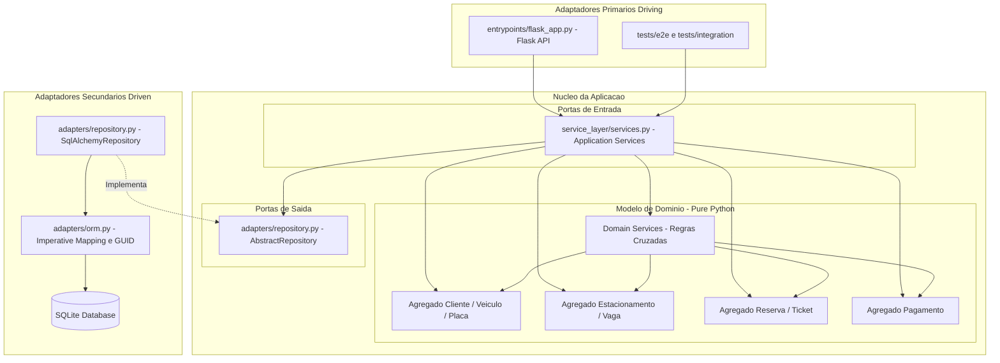

# Partes 1 e 5

# Parte 1 — Classificação dos Conceitos

| Conceito | Classificação | Justificativa (1 frase) |
| :--- | :--- | :--- |
| **Requisicao** | Objeto de Valor | É um objeto imutável definido unicamente por seus atributos, sem identidade própria no tempo. |
| **Bolsa** | Entidade | Possui um identificador único (`codigo`) que mantém sua identidade ao longo das mutações de seu estado. |
| **reservar_para(...)** | Serviço de Domínio | Encapsula uma operação do negócio que orquestra múltiplas bolsas para aplicar a regra de seleção FEFO. |
| **SemBolsaCompativel** | Exceção de Domínio | Sinaliza a violação de uma regra de negócio quando nenhuma bolsa do estoque atende aos critérios solicitados. |

---

# Parte 5 — Questões Conceituais

1. **Requisicao é objeto de valor e Bolsa é entidade. O que quebraria, concretamente, se Bolsa comparasse por todos os seus atributos como uma dataclass congelada?**
Se `Bolsa` comparasse por todos os seus atributos, duas instâncias que representam a mesma bolsa física passariam a ser consideradas objetos totalmente diferentes no momento em que uma reserva alterasse o seu volume reservado. Isso destruiria a rastreabilidade da entidade no sistema, fazendo com que buscas, conjuntos (`set`) e operações de atualização falhassem ao tentar identificar a bolsa modificada.

2. **Por que hoje é um parâmetro em vez de uma chamada a date.today() dentro do modelo? Cite pelo menos um teste da Parte 3 que ficaria impossível ou frágil com date.today().**
Tornar `hoje` um parâmetro explícito garante um modelo puramente determinístico e livre de efeitos colaterais causados pelo relógio do sistema operacional. O teste `test_nao_atende_quando_a_bolsa_esta_vencida` ficaria extremamente frágil ou impossível de simular de forma repetível ao longo do tempo se a checagem utilizasse a data real da execução do `pytest`.

3. **Por que reservar_para é uma função de domínio e não mais um método de Bolsa?**
A função `reservar_para` precisa analisar e ordenar uma coleção de instâncias de bolsas (`Iterable[Bolsa]`) para determinar qual é a ideal segundo o algoritmo FEFO. Atribuir essa responsabilidade a um método dentro de `Bolsa` violaria o encapsulamento e a coesão, pois uma bolsa individual não deve possuir conhecimento nem controle sobre as outras bolsas do estoque.

4. **Por que SemBolsaCompativel é uma exceção própria do domínio, e não um ValueError genérico nem um erro HTTP 400? Quem decide o código HTTP, e em que camada?**
`SemBolsaCompativel` expressa uma falha de negócio explícita na linguagem ubíqua, sem acoplar a regra de negócio a detalhes da linguagem Python ou de protocolos de rede. Quem decide a tradução desta exceção para um código HTTP 400 ou 404 é a camada de Apresentação/API, mantendo a camada de domínio completamente isolada da infraestrutura Web.

5. **Suponha que, no sistema legado, a ordem FEFO fosse obtida por um ORDER BY data_validade dentro do SQL. Qual regra de negócio deixaria de existir no código Python, e por que isso é um problema?**
A regra de seleção FEFO com critério de desempate alfabético (R6) deixaria de existir na camada de domínio em Python. Isso é um problema porque vaza regras de negócio cruciais para a infraestrutura de banco de dados, impedindo testes de unidade em memória, acoplando a aplicação ao SQL e gerando os sintomas de rigidez, fragilidade e viscosidade.


TESTE PARA OUTRO PROJETO:

**Diagrama Arquitetural:**




=====================================================

Testes outro projeto

# Registros de Refatoração SOLID - Checkpoint 2

## Integrante: Kennedy Soares
**Módulo / Agregado:** Agregado Cliente (`Cliente`, `Veiculo`, `Placa`)

---

### 1. Princípios Violados e Trecho de Código ("Antes")
* **Princípios Violados:** 
  - **SRP** — *Single Responsibility Principle* (Princípio da Responsabilidade Única)
  - **OCP** — *Open-Closed Principle* (Princípio do Aberto/Fechado)
* **Hash do Commit "Antes":** `1564c18` em 29-09-26 *(Commit do histórico real anterior a 06/10)*
* **Trecho do Código "Antes" (`src/estacionamento/domain/model.py`):**

```python
# Trecho do commit 1564c18 onde Placa agia apenas como contêiner de dados
@dataclass(frozen=True)
class Placa:
    numero: str
```

### 2. Problema Concreto
2.1 Violação do SRP: O Value Object Placa era um mero contêiner anêmico sem garantir suas próprias invariantes de formato (caracteres nulos, tamanho incorreto ou padrões fora do padrão nacional/Mercosul). Isso forçava a camada de aplicação (services.py) a efetuar validações imperativas externas, espalhando responsabilidades de validação.

2.2 Violação do OCP: Se o sistema precisasse passar a aceitar um novo formato de placa (ex.: padrão antigo ABC-1234 vs. padrão Mercosul ABC1D23), seria necessário modificar e adicionar estruturas condicionais (if/elif) nos chamadores e rotas, alterando código testado e correndo o risco de gerar regressões.

### 3. Refatoração e Código ("Depois")

Hash do Commit "Depois": 841bc73

Trecho do Código Refatorado (src/estacionamento/domain/model.py):

import re
from dataclasses import dataclass

@dataclass(frozen=True)
class Placa:
    numero: str

    def __post_init__(self):
        # Validação centralizada garantindo invariante e encapsulamento (SRP)
        if not self.numero or not self._validar_formato(self.numero):
            raise ValueError(f"Placa inválida: '{self.numero}' não atende ao formato esperado.")

    @staticmethod
    def _validar_formato(placa_str: str) -> bool:
        # Padrão flexível via Regex que estende o suporte ao formato antigo e Mercosul (OCP)
        padrao = r'^[A-Z]{3}[0-9][A-Z0-9][0-9]{2}$'
        return bool(re.match(padrao, placa_str.upper().replace("-", "")))

### 4. Garantia por Testes Automatizados

A suíte completa de testes unitários, de repositório e E2E da API REST foi executada com sucesso após a refatoração.

- Comando Executado: python -m pytest -o pythonpath=src

- Resultado: 48 passed in 1.43s (100% dos testes aprovados, garantindo retrocompatibilidade das rotas existentes e barrando a criação de placas sintaticamente inválidas).

### 5. Análise do Custo da Refatoração(Trade-offs)Custo:

 Inclusão da execução de expressões regulares no método __post_init__ do Value Object.   


 ### teste outro projeto:


 classDiagram
    %% Agregado Cliente / Veiculo
    class Cliente {
        +UUID id_cliente
        +String nome
        +String cpf
        +String telefone
        +String email
        +List~Veiculo~ veiculos
        +EstrategiaDesconto estrategia_desconto
        +cadastrar_veiculo(veiculo: Veiculo) void
        +remover_veiculo(placa: Placa) void
        +alterar_estrategia_desconto(nova_estrategia: EstrategiaDesconto) void
        +calcular_valor_com_desconto(valor_base: float) float
    }

    class Veiculo {
        +UUID id_veiculo
        +Placa placa
        +String tipo
    }

    class Placa {
        +String numero
        -_validar_formato(placa_str: String) bool
    }

    %% Estrutura do Padrão GoF: Strategy
    class EstrategiaDesconto {
        <<interface>>
        +calcular_desconto(valor_base: float) float*
    }

    class SemDesconto {
        +calcular_desconto(valor_base: float) float
    }

    class DescontoMensalista {
        +calcular_desconto(valor_base: float) float
    }

    class DescontoVIP {
        +calcular_desconto(valor_base: float) float
    }

    %% Relacionamentos do Domínio
    Cliente "1" *-- "*" Veiculo : contem
    Veiculo "1" *-- "1" Placa : possui

    %% Relacionamentos do Padrão Strategy
    Cliente "1" o-- "1" EstrategiaDesconto : usa (Contexto)
    EstrategiaDesconto <|.. SemDesconto : implementa
    EstrategiaDesconto <|.. DescontoMensalista : implementa
    EstrategiaDesconto <|.. DescontoVIP : implementa

    %% Destaques dos Participantes (Estilização)
    style Cliente fill:#e1f5fe,stroke:#0288d1,stroke-width:2px
    style EstrategiaDesconto fill:#fff3e0,stroke:#f57c00,stroke-width:2px
    style SemDesconto fill:#e8f5e9,stroke:#388e3c,stroke-width:1px
    style DescontoMensalista fill:#e8f5e9,stroke:#388e3c,stroke-width:1px
    style DescontoVIP fill:#e8f5e9,stroke:#388e3c,stroke-width:1px


