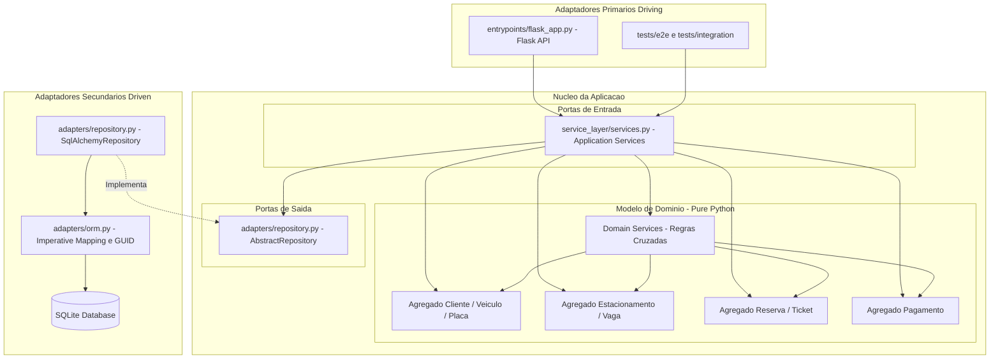

# Partes 1 e 5

# Parte 1 — Classificação dos Conceitos

| Conceito | Classificação | Justificativa (1 frase) |
| :--- | :--- | :--- |
| **Requisicao** | Objeto de Valor | É um objeto imutável definido unicamente por seus atributos, sem identidade própria no tempo. |
| **Bolsa** | Entidade | Possui um identificador único (`codigo`) que mantém sua identidade ao longo das mutações de seu estado. |
| **reservar_para(...)** | Serviço de Domínio | Encapsula uma operação do negócio que orquestra múltiplas bolsas para aplicar a regra de seleção FEFO. |
| **SemBolsaCompativel** | Exceção de Domínio | Sinaliza a violação de uma regra de negócio quando nenhuma bolsa do estoque atende aos critérios solicitados. |

---

# Parte 5 — Questões Conceituais

1. **Requisicao é objeto de valor e Bolsa é entidade. O que quebraria, concretamente, se Bolsa comparasse por todos os seus atributos como uma dataclass congelada?**
Se `Bolsa` comparasse por todos os seus atributos, duas instâncias que representam a mesma bolsa física passariam a ser consideradas objetos totalmente diferentes no momento em que uma reserva alterasse o seu volume reservado. Isso destruiria a rastreabilidade da entidade no sistema, fazendo com que buscas, conjuntos (`set`) e operações de atualização falhassem ao tentar identificar a bolsa modificada.

2. **Por que hoje é um parâmetro em vez de uma chamada a date.today() dentro do modelo? Cite pelo menos um teste da Parte 3 que ficaria impossível ou frágil com date.today().**
Tornar `hoje` um parâmetro explícito garante um modelo puramente determinístico e livre de efeitos colaterais causados pelo relógio do sistema operacional. O teste `test_nao_atende_quando_a_bolsa_esta_vencida` ficaria extremamente frágil ou impossível de simular de forma repetível ao longo do tempo se a checagem utilizasse a data real da execução do `pytest`.

3. **Por que reservar_para é uma função de domínio e não mais um método de Bolsa?**
A função `reservar_para` precisa analisar e ordenar uma coleção de instâncias de bolsas (`Iterable[Bolsa]`) para determinar qual é a ideal segundo o algoritmo FEFO. Atribuir essa responsabilidade a um método dentro de `Bolsa` violaria o encapsulamento e a coesão, pois uma bolsa individual não deve possuir conhecimento nem controle sobre as outras bolsas do estoque.

4. **Por que SemBolsaCompativel é uma exceção própria do domínio, e não um ValueError genérico nem um erro HTTP 400? Quem decide o código HTTP, e em que camada?**
`SemBolsaCompativel` expressa uma falha de negócio explícita na linguagem ubíqua, sem acoplar a regra de negócio a detalhes da linguagem Python ou de protocolos de rede. Quem decide a tradução desta exceção para um código HTTP 400 ou 404 é a camada de Apresentação/API, mantendo a camada de domínio completamente isolada da infraestrutura Web.

5. **Suponha que, no sistema legado, a ordem FEFO fosse obtida por um ORDER BY data_validade dentro do SQL. Qual regra de negócio deixaria de existir no código Python, e por que isso é um problema?**
A regra de seleção FEFO com critério de desempate alfabético (R6) deixaria de existir na camada de domínio em Python. Isso é um problema porque vaza regras de negócio cruciais para a infraestrutura de banco de dados, impedindo testes de unidade em memória, acoplando a aplicação ao SQL e gerando os sintomas de rigidez, fragilidade e viscosidade.

TESTE PARA OUTRO PROJETO:

**Diagrama Arquitetural:**

