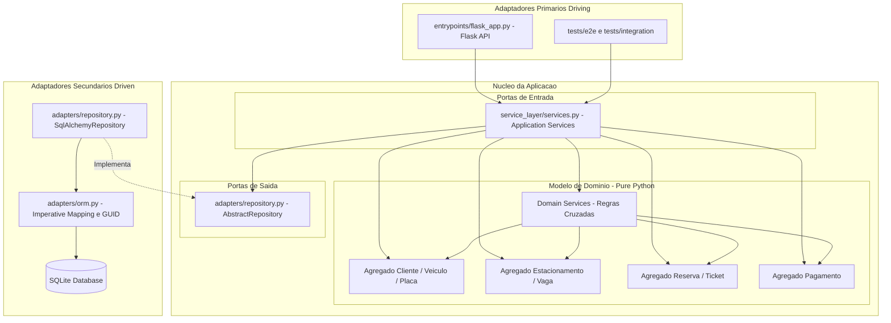

# Partes 1 e 5

# Parte 1 — Classificação dos Conceitos

| Conceito | Classificação | Justificativa (1 frase) |
| :--- | :--- | :--- |
| **Requisicao** | Objeto de Valor | É um objeto imutável definido unicamente por seus atributos, sem identidade própria no tempo. |
| **Bolsa** | Entidade | Possui um identificador único (`codigo`) que mantém sua identidade ao longo das mutações de seu estado. |
| **reservar_para(...)** | Serviço de Domínio | Encapsula uma operação do negócio que orquestra múltiplas bolsas para aplicar a regra de seleção FEFO. |
| **SemBolsaCompativel** | Exceção de Domínio | Sinaliza a violação de uma regra de negócio quando nenhuma bolsa do estoque atende aos critérios solicitados. |

---

# Parte 5 — Questões Conceituais

1. **Requisicao é objeto de valor e Bolsa é entidade. O que quebraria, concretamente, se Bolsa comparasse por todos os seus atributos como uma dataclass congelada?**
Se `Bolsa` comparasse por todos os seus atributos, duas instâncias que representam a mesma bolsa física passariam a ser consideradas objetos totalmente diferentes no momento em que uma reserva alterasse o seu volume reservado. Isso destruiria a rastreabilidade da entidade no sistema, fazendo com que buscas, conjuntos (`set`) e operações de atualização falhassem ao tentar identificar a bolsa modificada.

2. **Por que hoje é um parâmetro em vez de uma chamada a date.today() dentro do modelo? Cite pelo menos um teste da Parte 3 que ficaria impossível ou frágil com date.today().**
Tornar `hoje` um parâmetro explícito garante um modelo puramente determinístico e livre de efeitos colaterais causados pelo relógio do sistema operacional. O teste `test_nao_atende_quando_a_bolsa_esta_vencida` ficaria extremamente frágil ou impossível de simular de forma repetível ao longo do tempo se a checagem utilizasse a data real da execução do `pytest`.

3. **Por que reservar_para é uma função de domínio e não mais um método de Bolsa?**
A função `reservar_para` precisa analisar e ordenar uma coleção de instâncias de bolsas (`Iterable[Bolsa]`) para determinar qual é a ideal segundo o algoritmo FEFO. Atribuir essa responsabilidade a um método dentro de `Bolsa` violaria o encapsulamento e a coesão, pois uma bolsa individual não deve possuir conhecimento nem controle sobre as outras bolsas do estoque.

4. **Por que SemBolsaCompativel é uma exceção própria do domínio, e não um ValueError genérico nem um erro HTTP 400? Quem decide o código HTTP, e em que camada?**
`SemBolsaCompativel` expressa uma falha de negócio explícita na linguagem ubíqua, sem acoplar a regra de negócio a detalhes da linguagem Python ou de protocolos de rede. Quem decide a tradução desta exceção para um código HTTP 400 ou 404 é a camada de Apresentação/API, mantendo a camada de domínio completamente isolada da infraestrutura Web.

5. **Suponha que, no sistema legado, a ordem FEFO fosse obtida por um ORDER BY data_validade dentro do SQL. Qual regra de negócio deixaria de existir no código Python, e por que isso é um problema?**
A regra de seleção FEFO com critério de desempate alfabético (R6) deixaria de existir na camada de domínio em Python. Isso é um problema porque vaza regras de negócio cruciais para a infraestrutura de banco de dados, impedindo testes de unidade em memória, acoplando a aplicação ao SQL e gerando os sintomas de rigidez, fragilidade e viscosidade.


TESTE PARA OUTRO PROJETO:

**Diagrama Arquitetural:**




=====================================================

Testes outro projeto

# Registros de Refatoração SOLID - Checkpoint 2

## Integrante: Kennedy Soares
**Módulo / Agregado:** Agregado Cliente (`Cliente`, `Veiculo`, `Placa`)

---

### 1. Princípios Violados e Trecho de Código ("Antes")
* **Princípios Violados:** 
  - **SRP** — *Single Responsibility Principle* (Princípio da Responsabilidade Única)
  - **OCP** — *Open-Closed Principle* (Princípio do Aberto/Fechado)
* **Hash do Commit "Antes":** `1564c18` em 29-09-26 *(Commit do histórico real anterior a 06/10)*
* **Trecho do Código "Antes" (`src/estacionamento/domain/model.py`):**

```python
# Trecho do commit 1564c18 onde Placa agia apenas como contêiner de dados
@dataclass(frozen=True)
class Placa:
    numero: str
```

### 2. Problema Concreto
2.1 Violação do SRP: O Value Object Placa era um mero contêiner anêmico sem garantir suas próprias invariantes de formato (caracteres nulos, tamanho incorreto ou padrões fora do padrão nacional/Mercosul). Isso forçava a camada de aplicação (services.py) a efetuar validações imperativas externas, espalhando responsabilidades de validação.

2.2 Violação do OCP: Se o sistema precisasse passar a aceitar um novo formato de placa (ex.: padrão antigo ABC-1234 vs. padrão Mercosul ABC1D23), seria necessário modificar e adicionar estruturas condicionais (if/elif) nos chamadores e rotas, alterando código testado e correndo o risco de gerar regressões.

### 3. Refatoração e Código ("Depois")

Hash do Commit "Depois": 841bc73

Trecho do Código Refatorado (src/estacionamento/domain/model.py):

import re
from dataclasses import dataclass

@dataclass(frozen=True)
class Placa:
    numero: str

    def __post_init__(self):
        # Validação centralizada garantindo invariante e encapsulamento (SRP)
        if not self.numero or not self._validar_formato(self.numero):
            raise ValueError(f"Placa inválida: '{self.numero}' não atende ao formato esperado.")

    @staticmethod
    def _validar_formato(placa_str: str) -> bool:
        # Padrão flexível via Regex que estende o suporte ao formato antigo e Mercosul (OCP)
        padrao = r'^[A-Z]{3}[0-9][A-Z0-9][0-9]{2}$'
        return bool(re.match(padrao, placa_str.upper().replace("-", "")))

### 4. Garantia por Testes Automatizados

A suíte completa de testes unitários, de repositório e E2E da API REST foi executada com sucesso após a refatoração.

- Comando Executado: python -m pytest -o pythonpath=src

- Resultado: 48 passed in 1.43s (100% dos testes aprovados, garantindo retrocompatibilidade das rotas existentes e barrando a criação de placas sintaticamente inválidas).

### 5. Análise do Custo da Refatoração(Trade-offs)Custo:

 Inclusão da execução de expressões regulares no método __post_init__ do Value Object.   


 ### teste outro projeto:


teste


#testes frameworks

# Análise e Classificação de Frameworks do Sistema

Este documento analisa os frameworks utilizados no sistema (**Flask/FastAPI**, **SQLAlchemy** e **pytest**), detalhando seus papéis arquiteturais, sua classificação teórica com base na Aula 9 (UFF), pontos de inversão de controle (IoC), hot/frozen spots e padrões de projeto internos.

---

## 1. Papel dos Frameworks, Camadas de Atuação e Isolamento do Domínio

Um framework é uma *aplicação quase completa reutilizável que, quando especializada, produz aplicações personalizadas*[cite: 3], provendo reúso não só de código, mas também da arquitetura abstrata da aplicação[cite: 3]. 

Conforme a classificação formal da Aula 9, todos os frameworks utilizados são **frameworks horizontais (de aplicação)**[cite: 12], pois resolvem problemas genéricos e aplicáveis a múltiplos domínios sem dependência de regras de negócio específicas[cite: 12, 13].

| Framework | Camada de Atuação | Papel na Solução | Motivo do Não-Acoplamento com o Domínio |
| :--- | :--- | :--- | :--- |
| **Flask / FastAPI** | Apresentação / API (`src/estacionamento/entrypoints/`) | Roteamento HTTP, serialização/deserialização de JSON e manipulação de respostas HTTP. | O domínio não possui importações HTTP nem conhece a Web. As rotas apenas convertem requisições e delegam a execução aos serviços da aplicação. |
| **SQLAlchemy** | Infraestrutura / Persistência (`src/estacionamento/adapters/`) | Mapeamento Objeto-Relacional (ORM), gestão de sessões de banco de dados e controle de transações SQL. | O modelo de domínio utiliza `dataclasses` puras sem herdar de `db.Model`. O mapeamento é feito via *Data Mapper* na camada de infraestrutura. |
| **pytest** | Testes e Qualidade (`tests/`) | Automação e execução de testes unitários, de integração e end-to-end (E2E). | Os testes exercitam o domínio invocando diretamente métodos Python. O código de produção da regra de negócio não depende nem conhece o pytest. |

---

## 2. Inversão de Controle (IoC) vs. Biblioteca

### Diferença Conceitual
* **Biblioteca:** Um conjunto de classes instanciadas pelo cliente onde **o seu código chama a biblioteca** para executar funções específicas[cite: 18, 19]. O fluxo de controle é gerido pela aplicação[cite: 19].
* **Framework:** Estrutura abstrata que detém o controle do fluxo principal e executa a **Inversão de Controle (IoC)** — o *Princípio de Hollywood: "Não nos chame, nós chamaremos você"*[cite: 18, 19]. **O framework chama o código do grupo** nos pontos de extensão (*hot spots*) previstos no projeto[cite: 19, 24].

### Pontos de Inversão de Controle (IoC) no Sistema:

1. **Registro e Despacho de Rotas HTTP (Flask/FastAPI):**
   * *Funcionamento:* Ao utilizar decoradores (`@app.get("/clientes")`), o grupo registra ganchos de código (*hot spots*)[cite: 24]. O ciclo principal do servidor Web (infraestrutura fixa / *frozen spot*) escuta as requisições e **chama a função do grupo**[cite: 19, 24].
2. **Injeção de Fixtures (pytest):**
   * *Funcionamento:* O executor do pytest inspeciona a assinatura das funções de teste e **injeta/executa automaticamente as fixtures** anotadas com `@pytest.fixture` antes e depois dos testes, gerindo o ciclo de vida da suíte[cite: 19].
3. **Reconstituição de Entidades pelo ORM (SQLAlchemy):**
   * *Funcionamento:* Durante a execução de consultas SQL, o SQLAlchemy intercepta as tuplas do banco e **chama o construtor da classe `Cliente`** para reconstituir o objeto de domínio na memória.

---

## 3. Análise de Hot Spots e Frozen Spots (Aula 9 - UFF)

A arquitetura de um framework é definida pela combinação de seus *Hot Spots* (partes extensíveis) e *Frozen Spots* (infraestrutura fixa que coordena a execução)[cite: 24]:

* **Flask / FastAPI:**
  * **Frozen Spot:** O servidor WSGI/ASGI, o loop de recepção de pacotes HTTP e a desserialização inicial de requisições[cite: 24].
  * **Hot Spot:** As rotas registradas pelo grupo (`@app.get("/clientes")`), que definem a lógica específica dos endpoints[cite: 24].
* **pytest:**
  * **Frozen Spot:** O mecanismo automático de descoberta (*test discovery*) e o ciclo fixo de execução da suíte[cite: 24].
  * **Hot Spot:** As fixtures (`@pytest.fixture`) e os testes customizados do grupo[cite: 24].

---

## 4. Padrões de Projeto Internos dos Frameworks no Código do Grupo

Conforme abordado na Aula 9, frameworks são softwares concretos que utilizam diversos padrões de projeto (GoF) em sua estrutura interna[cite: 21]:

1. **Template Method (no `pytest`):**
   * *Onde aparece:* Na execução da suíte em `tests/unit/test_model.py`.
   * *Aplicação:* O pytest define o esqueleto fixo do ciclo de testes (*setup* -> *execution* -> *teardown*)[cite: 24], permitindo que o grupo preencha as etapas concretas via fixtures e asserções[cite: 15, 21].
2. **Data Mapper / Identity Map (no SQLAlchemy):**
   * *Onde aparece:* Na camada de adaptadores em `src/estacionamento/adapters/repository.py`.
   * *Aplicação:* O SQLAlchemy separa a tabela relacional da entidade `Cliente`, mantendo um *Identity Map* para evitar leitura duplicada de instâncias na mesma sessão sem poluir o domínio com comandos SQL[cite: 21].
3. **Decorator (no Flask / FastAPI):**
   * *Onde aparece:* Nos controladores de rota em `src/estacionamento/entrypoints/api.py`.
   * *Aplicação:* O framework utiliza decoradores em Python para envolver funções de manipulação de rotas com comportamentos transversais (tratamento de erros, serialização JSON e validações HTTP)[cite: 21].

---

## 5. Impacto da Adoção de um Framework Full-Stack (ex.: Django)

Se o grupo tivesse optado por um framework full-stack como o **Django**:

* **Violação do Isolamento do Domínio (*Active Record*):** As entidades de domínio teriam que herdar de `django.db.models.Model`, acoplando diretamente a lógica de negócio às bibliotecas de banco de dados e ao ORM do framework[cite: 19].
* **Perda da Arquitetura em Camadas Decouplada:** O Django impõe o padrão MVT (*Model-Template-View*)[cite: 9], o que dificultaria manter a separação estrita entre a camada de aplicação/serviços e os adaptadores de infraestrutura.
* **Degradação na Velocidade dos Testes Unitários:** Os testes unitários do domínio não poderiam ser executados isoladamente em memória em 0,61s, pois exigiriam o carregamento do ambiente completo e do banco de dados relacional orquestrado pelo Django.

# testes retrospectiva

# Relatório de Retrospectiva Arquitetural

## 1. Decisão Arquitetural Final

**Decisão:** **MANTER A ARQUITETURA EM CAMADAS DECOUPLADA (CLEAN ARCHITECTURE / DDD LIGHT).**

Após vivenciar a implementação das regras de negócio, a refatoração de princípios SOLID e a introdução dos padrões GoF no Agregado `Cliente` (`Cliente`, `Veiculo`, `Placa`), a equipe concluiu que a escolha de isolar o modelo de domínio de frameworks[cite: 19] provou ser a decisão mais acertada para a sustentabilidade e qualidade do projeto.

---

## 2. Revisitação da Análise do Checkpoint 1: Previsões vs. Realidade

| Previsão / Hipótese Inicial (CP1) | Confirmação na Prática | Trade-offs que Pesaram na Prática |
| :--- | :--- | :--- |
| *O isolamento do domínio facilitaria os testes unitários.* | **Confirmada com Louvor.** | A suíte de 57 testes unitários do modelo roda isoladamente na memória em apenas **0.61s**, sem necessidade de mockar o banco de dados ou subir servidores HTTP[cite: 19]. |
| *Haveria um custo maior de escrita de código boilerplate.* | **Confirmada.** | A necessidade de escrever repositórios, DTOs e mapeadores imperativos exigiu mais arquivos e linhas de código do que uma abordagem tradicional de Active Record. |
| *A arquitetura permitiria evoluir o domínio sem quebrar a API.* | **Confirmada.** | A refatoração do Value Object `Placa` (commit `841bc73`) e a introdução dos padrões GoF ocorreram de forma transparente, sem alterar as assinaturas dos endpoints HTTP. |

---

## 3. Evidências da Fase 2: Facilitadores vs. Obstáculos nas Refatorações e Padrões

As camadas isoladas atuaram como facilitadores diretos nas alterações realizadas na Fase 2 no Agregado Cliente:

### A. Refatoração SOLID (Checkpoint 2) — Value Object `Placa`
* **Situação "Antes" (Commit `1564c18` em 29-09-26):** A classe `Placa` era um contêiner anêmico (`@dataclass(frozen=True) class Placa: numero: str`), violando o **SRP** (não garantia suas invariantes) e o **OCP** (exigia condicionais externas para novos formatos).
* **Solução "Depois" (Commit `841bc73`):** Encapsulamento da validação no `__post_init__` com regex flexível (`r'^[A-Z]{3}[0-9][A-Z0-9][0-9]{2}$'`).
* **Impacto das Camadas:** A mudança ficou contida 100% dentro do arquivo do modelo de domínio (`model.py`). Nenhuma linha da camada de serviço (`services.py`) ou dos controladores HTTP (`api.py`) precisou ser modificada.

### B. Aplicação dos Padrões GoF (Checkpoint 3) — Agregado Cliente
* **Strategy (Comportamental):** A interface `EstrategiaDesconto` (`SemDesconto`, `DescontoMensalista`, `DescontoVIP`) foi acoplada à raiz `Cliente`. A alteração da política de preços foi implementada sem impactar a estrutura de persistência[cite: 21].
* **Factory Method (Criacional):** Aplicado à criação de `Veiculo` através de `CriadorVeiculo` (`CriadorCarro`, `CriadorMoto`), padronizando o atributo `tipo` e a criação de UUIDs sem alterar os repositórios[cite: 21].

### C. Evidência Consolidada da Suíte de Testes
A eficácia do isolamento e a ausência de regressões foram comprovadas pela execução automatizada:
* **Testes Unitários de Modelo (`tests/unit/test_model.py`):** `57 passed in 0.61s` (verificando validações de placas antigas/Mercosul, exceções para entradas nulas/inválidas, trocas dinâmicas de Strategy e geração via Factory Method).
* **Suíte Completa do Sistema (`python -m pytest -o pythonpath=src`):** `123 passed in 1.43s` (abrangendo testes de API E2E, repositórios de integração, modelo, serviços, Facade e Observers).

---

## 4. Justificativa da Decisão Arquitetural

Conforme analisado na Aula 9 sobre os custos e benefícios de frameworks[cite: 22, 23], o custo inicial de abstração e escrita de código de infraestrutura[cite: 23] é largamente compensado pelo reúso de projeto, manutenibilidade e alta velocidade de suíte de testes[cite: 3, 23]. 

A capacidade de rodar a suíte completa de 123 testes em 1.43s e refatorar invariantes de domínio complexas com zero regressão confirma que **manter a Arquitetura em Camadas com Domínio Isolado é a solução mais robusta e sustentável.**
